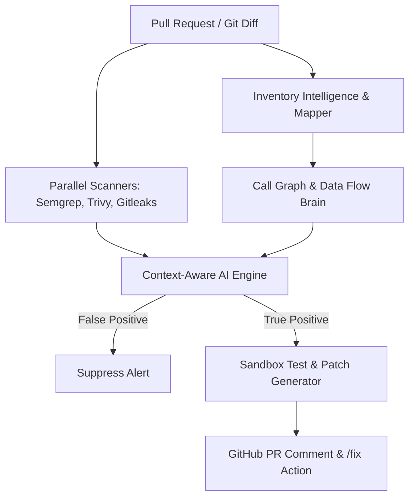

# A3-PS024-TC195: Context-Aware AI Security Validation & Auto-Remediation (GodSec)

**Team Code**: A3-PS024-TC195  
**Team Name**: GodSec  
**Institution / Event**: AIORI Hackathon 3  
**Date**: October 5, 2026  

---

## Slide 2: Abstract & Problem Description

### Problem Description
Modern software development and AI code assistants (such as Copilot, Cursor, and ChatGPT) rapidly accelerate feature delivery, but introduce severe security risks:
- **Insecure AI-Generated Code**: AI models generate code snippets in isolation, missing application context and introducing vulnerabilities (SQLi, command injection, insecure deserialization).
- **Dependency Misconfigurations & N-Day Vulnerabilities**: Open-source libraries often contain hidden misconfigurations (hardcoded secrets, weak ciphers) and unpatched N-day vulnerabilities.
- **Alert Fatigue in Legacy Tools**: Traditional rules-based SAST and SCA tools produce thousands of false positives because they lack application architecture awareness.
- **Delayed Security Reviews**: Penetration testing happens too late in the SDLC, leading to expensive rework and delayed releases.

---

## Slide 3: Background

### Background
Ensuring software security requires shifting left—embedding security checks directly into every pull request across the software development lifecycle (SDLC). However, traditional static analysis (SAST) and software composition analysis (SCA) rely on pattern matching and isolated file analysis. 

To scale security for AI-generated codebases, security tools must understand the **full application context**, including direct/transitive dependency trees, control flow, and data propagation. By combining deterministic open-source scanners with a semantic **Call Graph & Data Flow Brain**, security teams can achieve high-precision vulnerability detection with near-zero false positives and automated remediation.

---

## Slide 4: Literature & Standards Review

### Literature & Standards Review
- **OWASP Top 25 & CWE Top 25**: Standard baseline for identifying critical software weaknesses like injection flaws, broken access control, and insecure cryptographic storage.
- **Rules-Based SAST (Semgrep / Bandit / Gosec)**: Excellent at pattern-matching known vulnerabilities, but prone to high false-positive rates without architectural context.
- **Traditional SCA (Trivy / OWASP Dependency-Check)**: Reactive scanning against known CVE databases; limited visibility into transitive dependency reachability and custom misconfigurations.
- **Generic LLM-Based Code Scanners**: High compute cost and inconsistent context when scanning files in isolation. GodSec solves this by fusing deterministic tool outputs with centralized Call Graph reachability analysis.

---

## Slide 5: Proposed Solution

### Proposed Solution (GodSec Architecture)
GodSec is an end-to-end, context-aware AI security validation and auto-remediation platform consisting of five micro-components:
1. **Inventory Intelligence**: Automatically ingests repositories and maps direct/transitive dependencies and microservice topologies.
2. **Call Graph & Data Flow Brain**: Constructs semantic control flow and taint tracking graphs to trace data from entry points to dangerous sinks.
3. **Multi-Engine Scanner Layer**: Runs parallel open-source scanners (**Semgrep**, **Trivy**, **Gitleaks**) concurrently on every PR diff in under 60 seconds.
4. **Context-Aware AI Engine**: Validates raw alerts against the Call Graph Brain to eliminate unreachable dead code and confirm true positives.
5. **Sandbox Remediation & CI/CD Gate**: Automatically generates verified security patches and enables 1-click application via `/fix` PR comments.

---

## Slide 6: Solution Optimization

### Solution Optimization
Comparison between traditional security testing approaches and the GodSec optimized pipeline:

| Metric / Dimension | Traditional / Legacy Tools | GodSec Optimized Pipeline |
| :--- | :--- | :--- |
| **False Positive Rate** | High (50% – 80% noise) | Low (<5% via Call Graph Reachability) |
| **Scan Latency (PR)** | Slow (Hours / Pre-release pentest) | Fast (<60 seconds via parallel CI jobs) |
| **Remediation Speed** | Manual triage & ticket creation | Automated patch generation & 1-click `/fix` |
| **Dependency Context** | CVE database matching only | Transitive reachability & insecure default detection |

---

## Slide 7: Architecture Design (UML Diagram)

### Solution Architecture & Design

---

## Slide 8: Data Flow Diagram

### Data Flow Diagram (DFD)
1. **Ingress**: Developer pushes code or creates a Pull Request (`A3-PS024-TC195`).
2. **Parsing & Mapping**: Component 1 builds the repository inventory; Component 2 constructs the incremental Call Graph and Data Flow map.
3. **Scanning**: Component 3 triggers parallel open-source scans on the diff.
4. **Validation**: Component 4 correlates raw alerts with call slices to verify reachability.
5. **Egress / Remediation**: Component 5 generates verified patches and posts actionable GitHub PR alerts.

---

## Slide 9: Deployment Timeline

### Deployment Timeline
- **Phase 1 (Research & Architecture)**: Design inventory mapping and call graph extraction logic. Set up CI/CD test environment.
- **Phase 2 (Vulnerability Detection & Scanners)**: Integrate parallel Semgrep, Trivy, and Gitleaks engines with severity classification.
- **Phase 3 (AI Validation & Auto-Remediation)**: Build reachability validation engine, LLM prompt orchestration, and sandbox test verifier.
- **Phase 4 (Testing & Optimization)**: Benchmark detection accuracy, false positive reduction, and PR feedback latency against test suites.

---

## Slide 10: Bibliography

### Bibliography
[1] OWASP Foundation. *OWASP Top Ten Web Application Security Risks*. OWASP Benchmark Project.  
[2] Mitre Corporation. *CWE Top 25 Most Dangerous Software Weaknesses*. Common Weakness Enumeration.  
[3] Semgrep Inc. *Static Analysis and AST Pattern Matching in Modern CI/CD Pipelines*.  
[4] Aqua Security. *Trivy: Comprehensive Vulnerability Scanner for Containers and Git Repositories*.  

---

## Slide 11: Thank You

### Thank You for Your Attention!
**Team GodSec (A3-PS024-TC195)**  
*Proactive, Context-Aware Security for AI-Generated Code & Open-Source Dependencies.*
