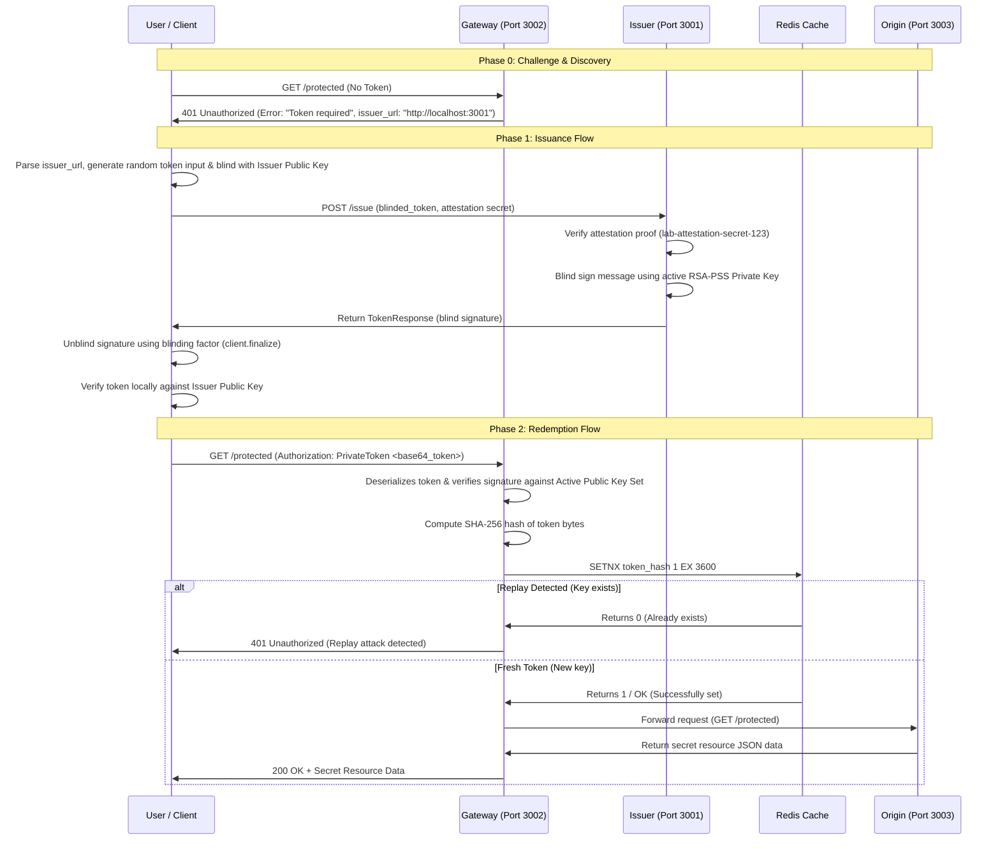

# Technical Architecture & End-to-End Data Flow Documentation
**Team Name**: GODSEC  
**Problem Statement**: PS-024 (Privacy Pass for Anonymous Client Authentication & Shared-IP Protection)

---

## 1. Introduction & System Overview
The Privacy Pass architecture allows clients to authenticate themselves to protected origin servers without revealing their identity or browsing history, even when operating behind shared network infrastructure (corporate proxies, university NATs, carrier CGNATs). 

The system consists of four primary decoupled microservices:
1. **Client**: Initiates requests, handles 401 challenges, generates cryptographic token requests, blinds them, communicates with the Issuer, unblinds signatures, and redeems tokens at the Gateway.
2. **Issuer** (Port `3001`): Validates attestation proofs and issues RSA-PSS blind signatures over client-blinded messages using time-bounded cryptographic keys.
3. **Gateway** (Port `3002`): Acts as the bouncer—issues 401 challenges pointing to the Issuer, intercepts incoming tokens, cryptographically verifies them against active public keys, enforces atomic single-use replay protection via Redis (`SETNX`), and forwards valid requests to the Origin.
4. **Origin** (Port `3003`): Serves protected resource data (`/protected`) and hosts the interactive system dashboard.

---

## 2. Technology Stack
- **Language & Runtime**: Node.js (ES Modules, top-level `await`)
- **Web Framework**: Express.js (REST APIs, CORS middleware)
- **Cryptography & Privacy Pass**: 
  - `@cloudflare/privacypass-ts` (Privacy Pass RFC 9576 / RFC 9578 implementation)
  - `@cloudflare/blindrsa-ts` (Blind RSA signature scheme - RSABSSA SHA-384 PSS)
  - Node.js WebCrypto (`node:crypto`)
- **Anti-Replay Cache**: Redis (`ioredis` client with atomic `SETNX` and TTL expiration)
- **Containerization**: Docker & Docker Compose

---

## 3. End-to-End User Flow & Data Journey (Source to Sink)



---

## 4. Content of Data Packets (Payload Specifications)

### Step 0: Gateway 401 Challenge (Discovery)
- **Payload Type**: HTTP 401 JSON response from Gateway when no token is present.
- **Content**:
  ```json
  {
    "error": "Token required",
    "issuer_url": "http://localhost:3001"
  }
  ```
- **Purpose**: Informs the Client where it must acquire a valid Privacy Pass token before retrying.

### Step 1: Token Request (Blinded Message)
- **Payload Type**: JSON body sent via HTTP POST to `http://localhost:3001/issue`.
- **Content**:
  ```json
  {
    "blinded_token": "00024920fd12c8e5d77b863055beed934926e9fcc459b8a06fb6ecde85f0ac88ec0727bb...",
    "attestation": "lab-attestation-secret-123"
  }
  ```
- **Structure Breakdown**:
  - `blinded_token`: Hex-encoded serialized `TokenRequest` containing `token_type` (0x0002), `truncated_token_key_id`, and the 256-byte blinded cryptographic message.
  - `attestation`: Shared secret proving the client passed an issuance challenge (CAPTCHA / device attestation).

### Step 2: Issuer Response (Blind Signature)
- **Payload Type**: JSON response from Issuer.
- **Content**:
  ```json
  {
    "blind_sig": "84d79108030f86fecacae5463ac7c9c1649910d3..."
  }
  ```
- **Structure Breakdown**:
  - `blind_sig`: Hex-encoded 256-byte blind signature generated by signing the blinded message with the Issuer's private RSA-PSS key.

### Step 3: Redemption Authorization Header
- **Payload Type**: HTTP Header sent to Gateway (`http://localhost:3002/protected`).
- **Content**:
  ```http
  Authorization: PrivateToken AALMgJ12JOTAXq1z6M86qr3rNSvwQmRQr186veg/7+IUsOcIQxubo66MDemQ8gqxu4Vy/yTqgo9PJa1Ot5PVZ...
  ```
- **Structure Breakdown**:
  - `PrivateToken`: Authentication scheme prefix.
  - `<base64_token>`: Base64-encoded binary serialization of the complete unblinded `Token`, containing `authInput` (nonce, challenge digest, key ID) and the 256-byte unblinded `authenticator`.

---

## 5. Key Architectural Challenges & Current Challenges Faced

1. **Replay Protection Concurrency & Race Conditions**:
   - *Challenge*: Multiple clients might attempt to redeem tokens concurrently. If check-then-set logic is split into two operations, a race condition could allow double-spending.
   - *Mitigation*: We use Redis **`SETNX` with TTL (`EX 3600`)** in a single atomic instruction. If the key already exists, Redis returns null and access is instantly rejected.
2. **Cryptographic Blinding vs. Unblinding Deserialization**:
   - *Challenge*: Distinguishing between a raw blind signature (`TokenResponse`) and a fully unblinded token (`Token`) during API handoffs.
   - *Mitigation*: Implemented a dedicated server-side helper endpoint (`/api/get-token`) that performs the complete client-side unblinding workflow before exposing tokens to the dashboard UI.
3. **Cross-Origin Context Binding (`origin_info`)**:
   - *Challenge*: Ensuring tokens issued for one Origin cannot be fraudulently replayed at another Origin.
   - *Mitigation*: Bound origin URLs into the `TokenChallenge` via `origin_info`, embedding challenge digests into `TokenInput`.
4. **Key Management & Sync**:
   - *Challenge*: Keeping Issuer public keys and private keys synchronized across client, issuer, and gateway microservices without accidental leakage.
   - *Mitigation*: Automated key generation in `issuer/keys.js`, persistent JSON JWK export (`issuer-public-key.json`), and strict `.gitignore` rules excluding private keys.

---

## 6. Enterprise Cryptographic Key Management & 24-Hour Rolling Key Rotation

To ensure forward secrecy, limit blast radii in case of private key compromise, and prevent indefinite token validity, the architecture incorporates an **automated 24-hour key rotation strategy with multi-instance rolling grace periods**:

1. **24-Hour Key Lifespan**: 
   - Issuer key pairs automatically rotate every 24 hours. Tokens signed under an expired key epoch are naturally rejected.
2. **Multi-Instance Rolling Deployment & Staggered Gap**:
   - When rotating keys, multiple instances of the Issuer microservice run concurrently behind a load balancer with a **5-second staggered startup gap**.
   - **Instance A** (serving Day N keys) and **Instance B** (serving Day N+1 keys) overlap during the rotation window.
3. **Gateway Multi-Key Verification (Grace Period)**:
   - During the transition window, the Gateway queries a centralized Issuer **JWKS (JSON Web Key Set)** endpoint containing both active public keys (`[Key N, Key N+1]`).
   - This guarantees that tokens issued moments before key rotation continue to redeem successfully without abrupt service interruption.
