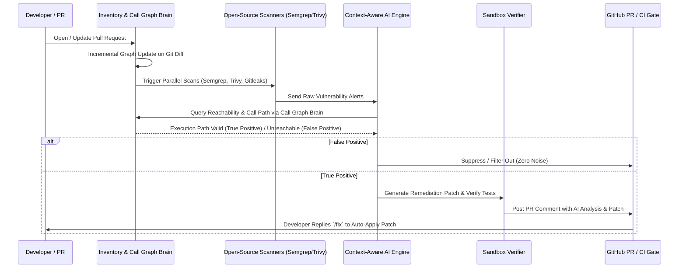

# GodSec: Context-Aware AI Security Scanner & Auto-Remediation Architecture

## 1. Executive Summary
This document outlines the component breakdown, end-to-end process workflow, and requirement fulfillment matrix for **GodSec**—an advanced, context-aware AI security validation and auto-remediation system. GodSec overcomes the limitations of traditional rules-based SAST, generic LLM scanners, and legacy SCA tools by combining open-source scanners with a **Call Graph & Data Flow Brain** and **AI-powered reachability validation**.

---

## 2. System Component Breakdown

The architecture is decoupled into five core micro-components:

### Component A: Inventory Intelligence & Architecture Mapper
- **Responsibility**: Ingests the raw repository, discovers files, modules, and dependencies (direct & transitive), and classifies the application structure (monolith vs. microservices).
- **Technology**: AST Parsers, Dependency Graph builders.

### Component B: Call Graph & Data Flow Brain
- **Responsibility**: Constructs a semantic call graph (control flow) and data flow map (taint tracking) across files and modules.
- **Function**: Enables precise **reachability analysis** to determine whether a vulnerable function is actually reachable in an execution path from an entry point.

### Component C: Multi-Engine Scanner Integration Layer
- **Responsibility**: Orchestrates open-source scanning engines (**Semgrep** for code patterns, **Trivy** for vulnerabilities & misconfigurations, **Gitleaks** for secrets) running concurrently in parallel CI jobs.
- **Function**: Aggregates raw findings into a unified format in under 30–60 seconds.

### Component D: Context-Aware AI Validation Engine
- **Responsibility**: Combines raw tool alerts with local code snippets and call path slices retrieved from the Call Graph Brain.
- **Function**: Eliminates false positives by verifying reachability, filtering out dead-code alerts, and validating true positives.

### Component E: Sandbox Remediation & CI/CD Gate (Human-in-the-Loop)
- **Responsibility**: Automatically generates precise security patches, verifies them in a test sandbox, posts structured alerts to GitHub PR comments, and applies fixes when developers trigger `/fix`.

---

## 3. End-to-End Process Workflow

---

## 4. Problem Statement Requirement Fulfillment Matrix

| Problem Statement Requirement | Traditional Approach Limitation | GodSec Solution & Fulfillment |
| :--- | :--- | :--- |
| **1. Code Security Scanner for AI Code** | High false positives, misses complex logic flaws. | **Multi-engine scanners + Call Graph Brain** accurately detects logic flaws and injection risks. |
| **2. CI/CD Integration Plugin** | Scans run too late (pre-release pentest), causing massive rework. | **Automated PR Security Gate** runs parallel scans in <60 seconds on every PR. |
| **3. Vulnerability Detection & N-Day Research** | Reactive reliance on public CVE databases. | **Proactive Misconfiguration & N-Day Discovery** identifies weak defaults and unknown risks. |
| **4. Remediation Module** | Long, unprioritized lists of raw alerts. | **AI-powered Auto-Remediation** generates verified code patches with 1-click `/fix` support. |
| **5. Low False Positives & Context Awareness** | Isolated file scanning leads to high noise. | **Reachability Analysis via Call Graph** filters out unreachable code and focuses only on real exploitable threats. |
